<div align="center">


# Kazoo

**Your AI usage, living in the MacBook notch.**

Glance up to see how much Codex, Claude, Cursor, Copilot, Gemini, Antigravity, OpenCode and OpenAI API usage you have left.
Click to compare providers. Connect everything from a native Mac window — no config files, no terminal.

[](#requirements)
[](https://swift.org)
[](#supported-providers)
[](#project-status)

[Features](#features) •
[Providers](#supported-providers) •
[Install](#installation) •
[Screenshots](#screenshots) •
[Usage](#usage) •
[Privacy](#privacy--security) •
[Development](docs/DEVELOPMENT.md)

<br>

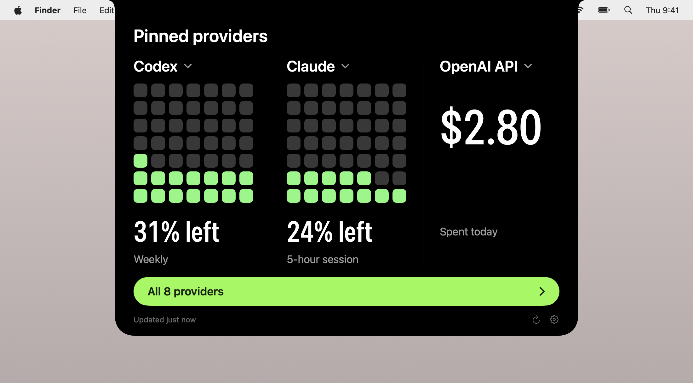

</div>

## Quick install

```bash
brew tap devmithunnath/kazoo https://github.com/devmithunnath/kazoo
brew install --cask devmithunnath/kazoo/kazoo
```

Then open **Kazoo** from Applications. See [Installation](#installation) for other options.

---

## Features

- **Lives in the notch** — your favorite provider's name sits on one side of the camera and its most important
  reading on the other, like `31% weekly left` or `$2.80 today`.
- **Compare at a glance** — click the notch for up to three pinned providers side by side, then drill into any of
  them for every window, reset time and limit.
- **Honest numbers** — missing data stays blank, a reported zero shows as zero, dollars never get a fake gauge, and
  countdowns come straight from provider timestamps.
- **Model limits stay separate** — a cap on one model never makes your whole account look empty.
- **Native setup** — search for a provider and connect it with one click: reuse a sign-in already on your Mac,
  approve a GitHub code, or paste an admin key. No shell commands.
- **Resilient** — offline or rate-limited? The last good reading stays up with its age while Kazoo backs off and
  retries.
- **Stays out of your way** — the panel never steals focus, closes with <kbd>Esc</kbd>, and falls back to the menu bar
  on displays without a notch.
- **Accessible** — VoiceOver labels on every reading, full keyboard shortcuts, and Reduce Motion support.

## Screenshots

### Always in view

Your favorite provider sits in the notch, with the camera area left clear.

<p align="center">
  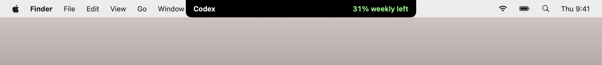
</p>

<p align="center">
  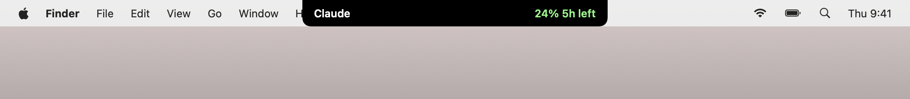
  <br>
  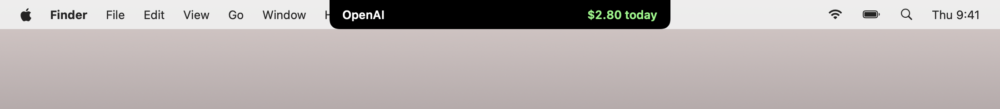
</p>

### Click for details

<table>
  <tr>
    <td width="50%">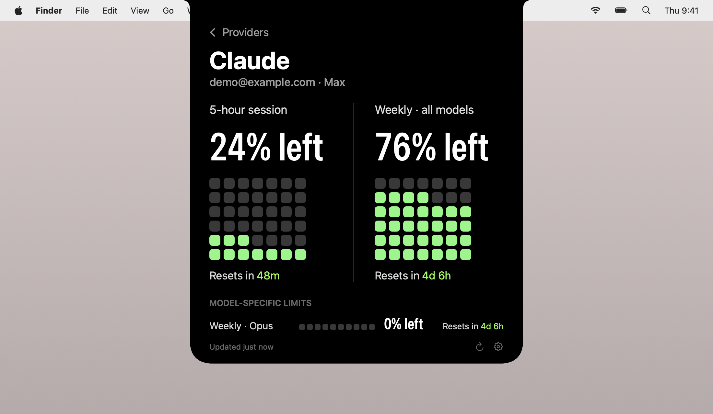</td>
    <td width="50%">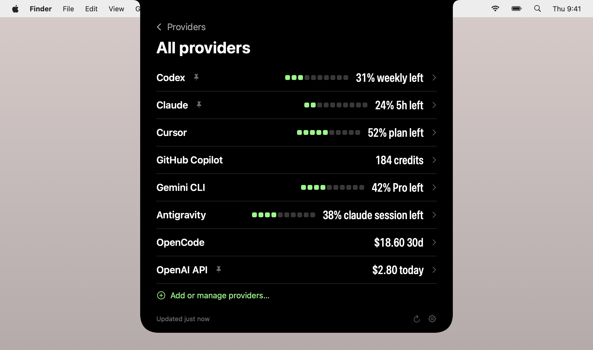</td>
  </tr>
  <tr>
    <td align="center"><sub>Every window with its own reset; model-specific limits listed separately</sub></td>
    <td align="center"><sub>All connected providers, in your order</sub></td>
  </tr>
</table>

### Every provider, honestly labeled

<table>
  <tr>
    <td align="center">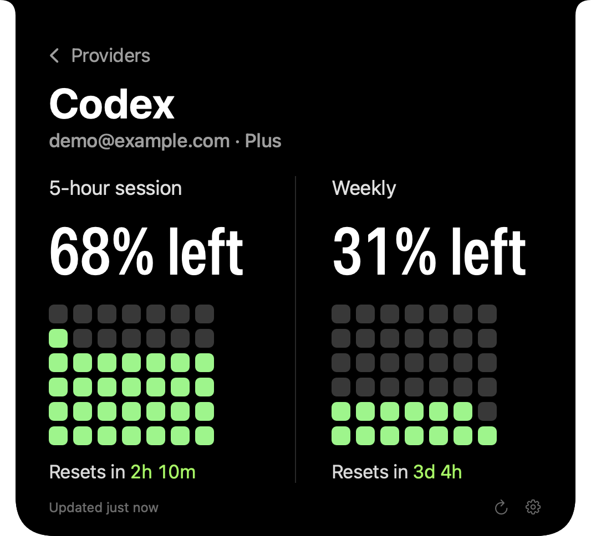<br><sub><b>Codex</b></sub></td>
    <td align="center">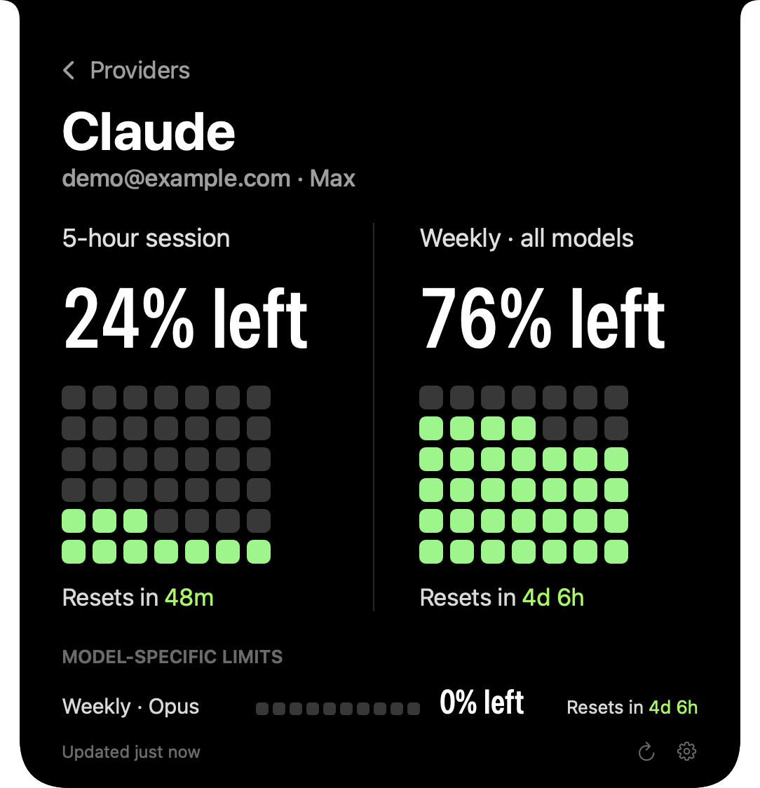<br><sub><b>Claude</b></sub></td>
    <td align="center"><br><sub><b>Cursor</b></sub></td>
    <td align="center">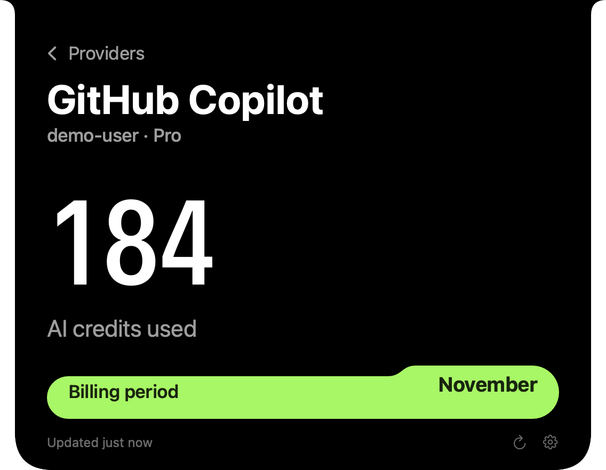<br><sub><b>GitHub Copilot</b></sub></td>
  </tr>
  <tr>
    <td align="center">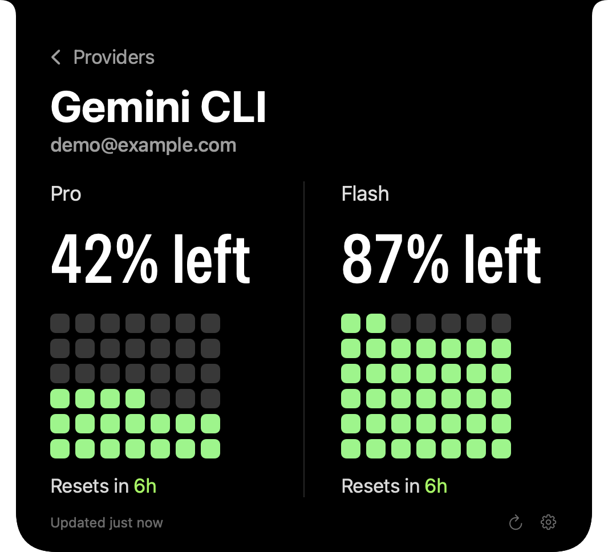<br><sub><b>Gemini CLI</b></sub></td>
    <td align="center">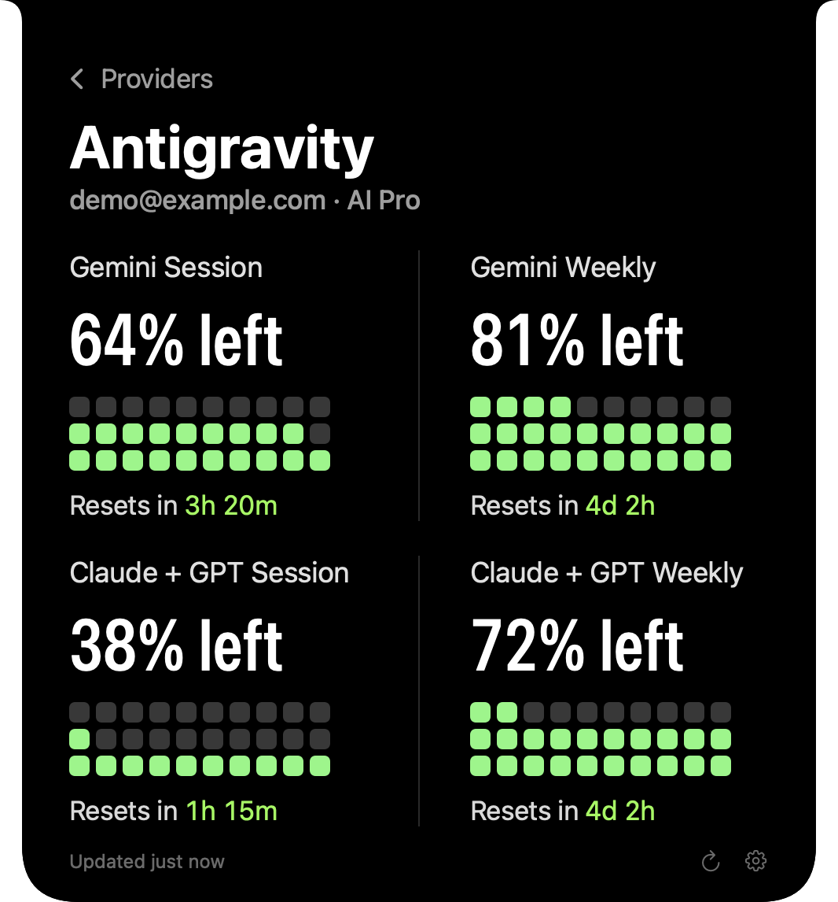<br><sub><b>Antigravity</b></sub></td>
    <td align="center">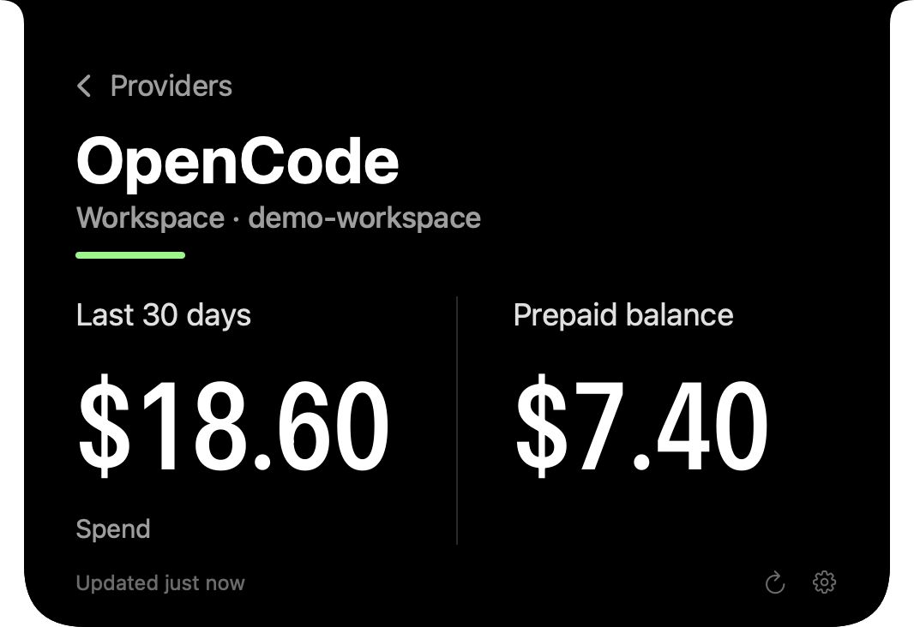<br><sub><b>OpenCode</b></sub></td>
    <td align="center"><br><sub><b>OpenAI API</b></sub></td>
  </tr>
</table>

When a provider is offline or a sign-in expires, Kazoo keeps the last reading, shows its age, and offers one fix:

<p align="center">
  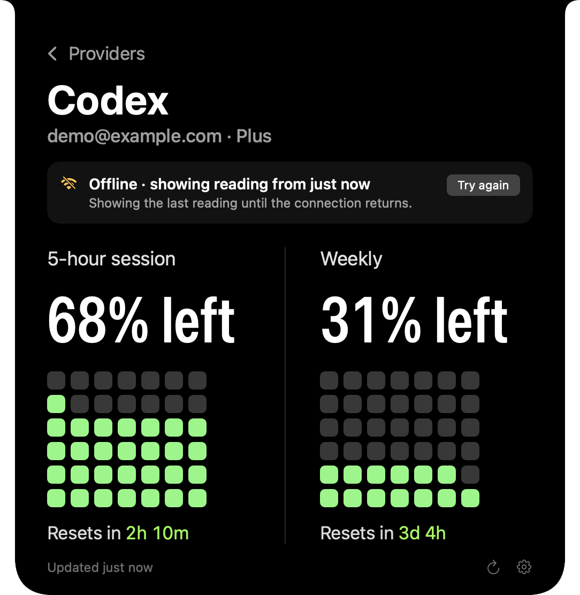
</p>

### Native setup and settings

<table>
  <tr>
    <td width="62%">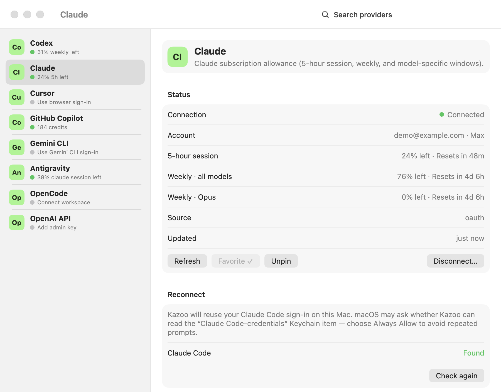</td>
    <td width="38%">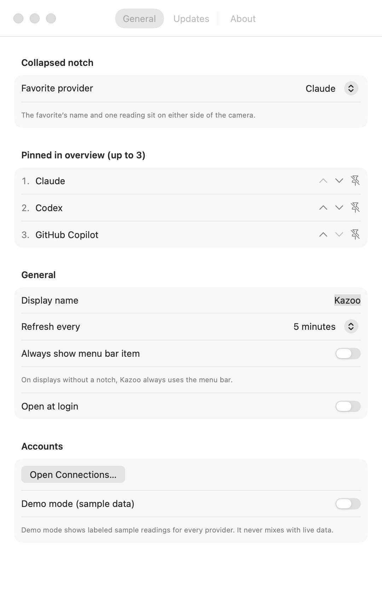</td>
  </tr>
  <tr>
    <td align="center"><sub>Search, connect and recover every provider from one window</sub></td>
    <td align="center"><sub>Favorite, pinned order, refresh and login options</sub></td>
  </tr>
</table>

<sub>Screenshots are rendered from Kazoo's own views using sample data. Regenerate them with
<code>cd KazooKit &amp;&amp; swift run kazoo-render ../docs/screenshots --screenshots</code>.</sub>

## Supported providers

| Provider | What you see | How you connect |
|---|---|---|
| **Codex** | 5-hour and weekly allowance, each with its own reset | Use the Codex sign-in on this Mac |
| **Claude** | 5-hour session, weekly (all models), model-specific weekly limits | Use the Claude Code sign-in on this Mac |
| **Cursor** | Included plan usage, billing cycle end, on-demand spend | Use your cursor.com browser session |
| **GitHub Copilot** | Premium-request quota, or AI credits used in the billing period | Sign in with GitHub (device code) |
| **Gemini CLI** | Pro, Flash and Flash Lite quota buckets | Use the Gemini CLI sign-in on this Mac |
| **Antigravity** | Gemini and Claude + GPT pools, each with session and weekly windows | Open the Antigravity app (or `agy` CLI), signed in with Google |
| **OpenCode** | 30-day spend, prepaid balance, or subscription windows | Use your opencode.ai browser session |
| **OpenAI API** | Organization spend today and over 7 days, with a daily chart | Add an organization Admin key |

Codex usage reflects your ChatGPT plan and is kept separate from OpenAI API organization spend. Google individual,
AI Pro and Ultra accounts can no longer sign in to Gemini CLI (since June 2026); use Antigravity to track those quotas.

## Installation

### Requirements

- macOS 14 Sonoma or later, on Apple silicon or Intel
- A Mac with a notch for the notch view (any Mac works through the menu bar)

### Homebrew (recommended)

```bash
brew tap devmithunnath/kazoo https://github.com/devmithunnath/kazoo
brew install --cask devmithunnath/kazoo/kazoo
open -a Kazoo
```

The first command adds Kazoo's tap (this repository) to Homebrew; you only need it once.

**Update**

Open **Settings**, choose the **Updates** tab, and click **Update with Homebrew** when a new version is available. Kazoo quits, runs the
Homebrew upgrade for you, and reopens. Or update from Terminal:

```bash
brew update && brew upgrade --cask kazoo
```

**Uninstall**

```bash
brew uninstall --cask kazoo
```

Add `--zap` to also remove Kazoo's preferences and cached readings. API keys stay in your Keychain under
`com.pipboxes.kazoo.credentials` until you disconnect the provider in Kazoo or delete them in Keychain Access.

> [!NOTE]
> Preview builds are not yet notarized by Apple. The cask clears the download quarantine flag so macOS lets Kazoo
> open. If you install manually instead, right-click **Kazoo.app** → **Open** the first time, or allow it in
> **System Settings → Privacy & Security**.

### Manual download

Download `Kazoo-<version>.zip` from the [latest release](https://github.com/devmithunnath/kazoo/releases/latest),
unzip it, and drag **Kazoo.app** into **Applications**.

### Build from source

Requires Xcode 26.

```bash
git clone https://github.com/devmithunnath/kazoo.git
cd kazoo
Scripts/build.sh
open dist/Kazoo.app
```

The first build downloads the Swift package dependencies and takes a few minutes. Prefer Xcode? Open
`Kazoo.xcodeproj` and run the **Kazoo** scheme.

> [!TIP]
> Want to look around before connecting anything? Launch with sample data:
> `open dist/Kazoo.app --args --demo`

## Usage

1. **Connect a provider.** On first launch, Kazoo opens **Connections**. Pick a provider and follow its one-step
   action. Kazoo fetches a first reading to confirm it works.
2. **Glance at the notch.** Your first connected provider becomes the favorite shown in the notch.
3. **Click for details.** One provider opens its detail view; several open the pinned overview.

| Action | Shortcut |
|---|---|
| Open a pinned provider | <kbd>1</kbd> <kbd>2</kbd> <kbd>3</kbd> |
| Go back | <kbd>⌘</kbd> <kbd>[</kbd> |
| Refresh | <kbd>⌘</kbd> <kbd>R</kbd> |
| Settings | <kbd>⌘</kbd> <kbd>,</kbd> |
| Close the panel | <kbd>Esc</kbd> or click outside |

Right-click the notch for **Refresh**, **Check for Updates…**, **Connections**, **Settings** and **Quit**. In
Settings you can change the favorite, reorder pinned providers, set the refresh interval, and turn on
**Open at login**.

### Updates

Kazoo checks GitHub for a new release once a day (turn this off in **Settings → Updates**). When one is available:

- **Installed with Homebrew:** **Update with Homebrew** runs `brew upgrade --cask kazoo` for you, so Homebrew stays
  in sync and `brew upgrade` keeps working too. Kazoo quits during the update and reopens when it's done.
- **Downloaded manually:** **Download** opens the new release's zip.

<p align="center">
  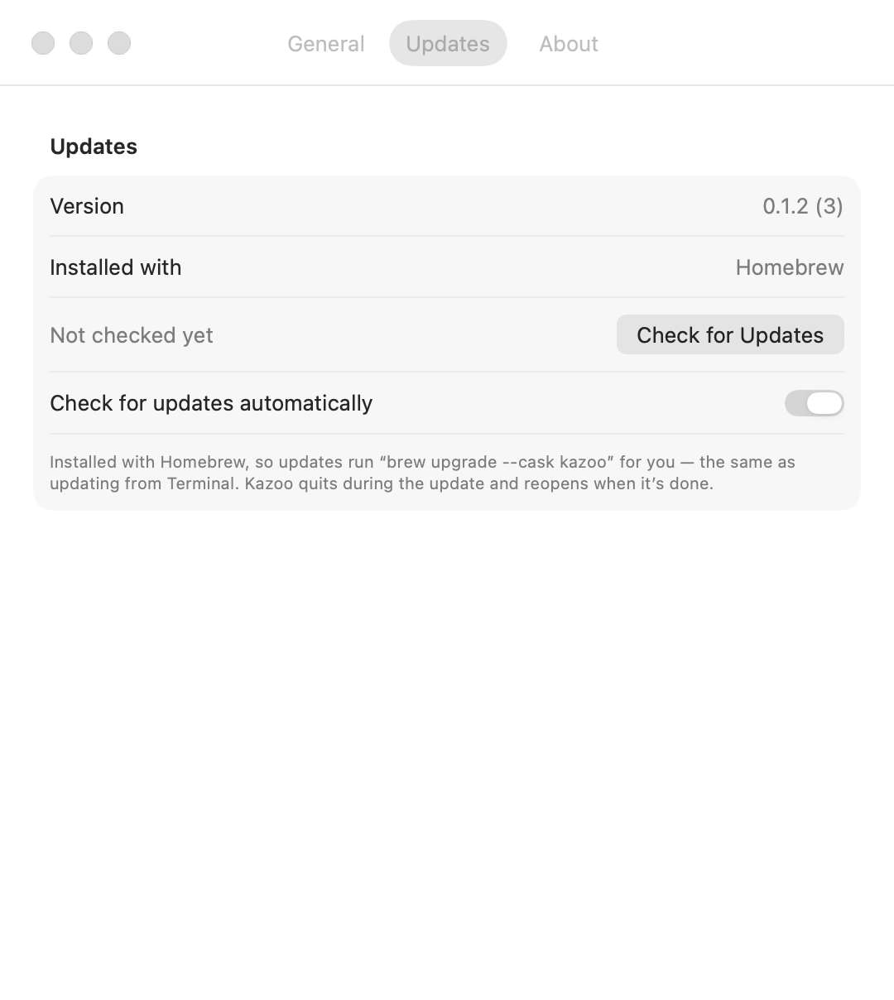
</p>

## Privacy & security

- **Everything runs on your Mac.** Kazoo talks only to the providers you connect, plus GitHub's public API once a
  day to check for updates (you can turn that off). No analytics, no servers of its own.
- **Secrets live in your Keychain.** API keys and GitHub tokens are stored there and never written to logs, config files or caches.
- **You stay in control.** Sign-ins owned by other tools (Codex, Claude Code, Gemini CLI, your browser) are read
  only after you click connect, and macOS asks before Kazoo can open a Keychain item. Disconnecting removes
  everything Kazoo stored.

## How it works

Kazoo is a native Swift, SwiftUI and AppKit app. Provider fetching and parsing come from
[CodexBar](https://github.com/steipete/CodexBar)'s `CodexBarCore`, pinned to a tested release and wrapped behind a
single app-owned interface. macOS has no notch API, so Kazoo measures the camera housing from the display's safe
area and draws borderless, non-activating panels around it.

See [docs/DEVELOPMENT.md](docs/DEVELOPMENT.md) for the architecture, tests and developer tools, and
[docs/RELEASING.md](docs/RELEASING.md) for signing and notarization.

## Project status

Kazoo is an early preview. All eight providers are implemented and covered by tests. Claude has been verified
against a live account; the others are still being exercised end to end. Bug reports and feedback are very welcome
in [Issues](https://github.com/devmithunnath/kazoo/issues).

## Contributing

Contributions are welcome. Before opening a pull request:

1. Build with `Scripts/build.sh` and run the tests with `cd KazooKit && swift test`.
2. Keep provider-specific logic inside `KazooKit/Sources/KazooKit/Engine` so the views stay provider-neutral.
3. Never commit credentials, and use fixtures rather than live account data in tests.

## Acknowledgements

- [CodexBar](https://github.com/steipete/CodexBar) by Peter Steinberger — the provider engine behind Kazoo.
- [ccusage](https://github.com/ccusage/ccusage) — inspiration for honest, local-first usage tracking.

## License

Kazoo bundles open-source software including CodexBarCore, QuickJS and SweetCookieKit (MIT) and swift-crypto,
swift-log and swift-asn1 (Apache 2.0). Full notices are in
[ThirdPartyNotices.txt](KazooKit/Sources/KazooKit/Resources/ThirdPartyNotices.txt) and in
**Settings → About → Third-party notices**.

<div align="center">
<sub>Made by <a href="https://github.com/devmithunnath">PipBoxes</a> for people who'd rather not run out of tokens mid-thought.</sub>
</div>
