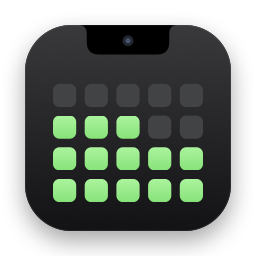
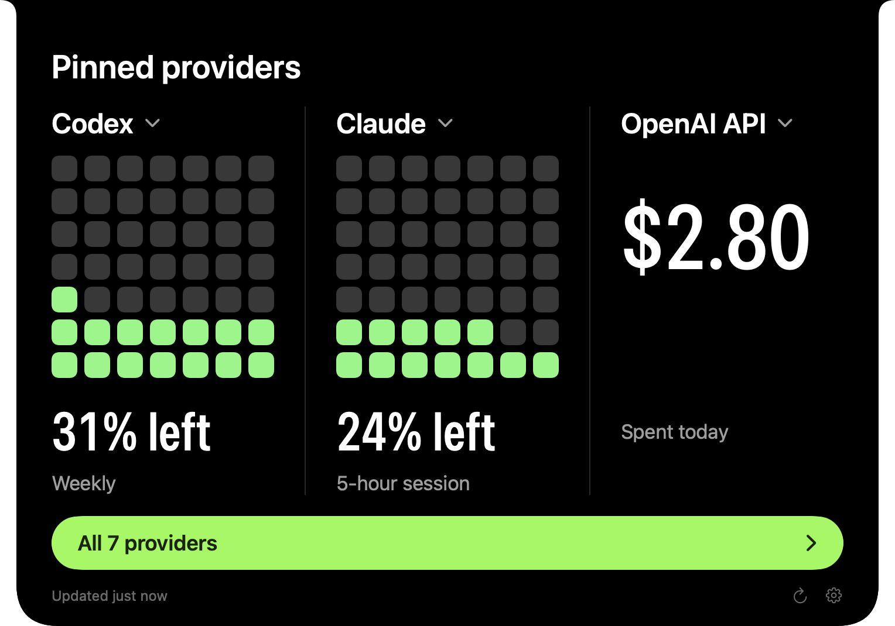
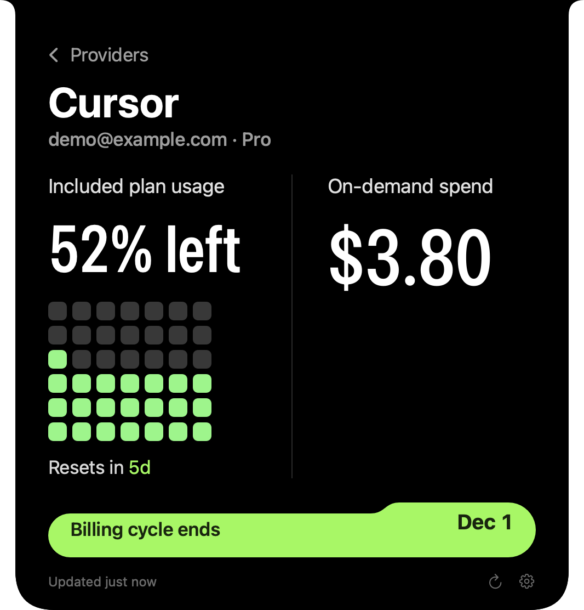
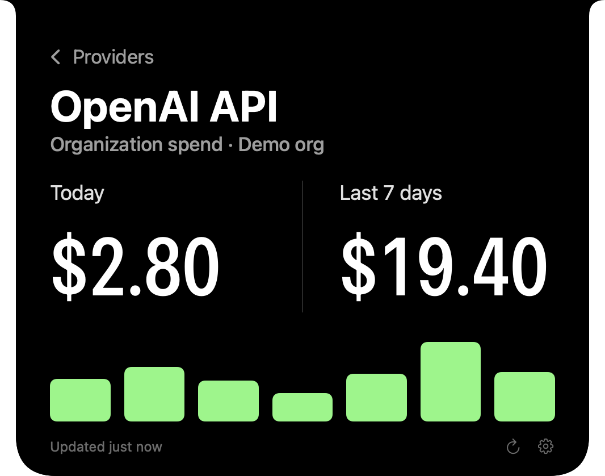

<div align="center">



# Kazoo

**Your AI usage, living in the MacBook notch.**

Glance up to see how much Codex, Claude, Cursor, Copilot, Gemini, OpenCode and OpenAI API usage you have left.
Click to compare providers. Connect everything from a native Mac window — no config files, no terminal.

[](#requirements)
[](https://swift.org)
[](#supported-providers)
[](#project-status)

[Features](#features) •
[Providers](#supported-providers) •
[Install](#installation) •
[Usage](#usage) •
[Privacy](#privacy--security) •
[Development](docs/DEVELOPMENT.md)

<br>



</div>

---

## Features

- **Lives in the notch** — your favorite provider's name sits on one side of the camera and its most important
  reading on the other, like `31% weekly left` or `$2.80 today`.
- **Compare at a glance** — click the notch for up to three pinned providers side by side, then drill into any of
  them for every window, reset time and limit.
- **Honest numbers** — missing data stays blank, a reported zero shows as zero, dollars never get a fake gauge, and
  countdowns come straight from provider timestamps.
- **Model limits stay separate** — a cap on one model never makes your whole account look empty.
- **Native setup** — search for a provider and connect it with one click: reuse a sign-in already on your Mac,
  approve a GitHub code, or paste an admin key. No shell commands.
- **Resilient** — offline or rate-limited? The last good reading stays up with its age while Kazoo backs off and
  retries.
- **Stays out of your way** — the panel never steals focus, closes with <kbd>Esc</kbd>, and falls back to the menu bar
  on displays without a notch.
- **Accessible** — VoiceOver labels on every reading, full keyboard shortcuts, and Reduce Motion support.

<div align="center">



</div>

## Supported providers

| Provider | What you see | How you connect |
|---|---|---|
| **Codex** | 5-hour and weekly allowance, each with its own reset | Use the Codex sign-in on this Mac |
| **Claude** | 5-hour session, weekly (all models), model-specific weekly limits | Use the Claude Code sign-in on this Mac |
| **Cursor** | Included plan usage, billing cycle end, on-demand spend | Use your cursor.com browser session |
| **GitHub Copilot** | Premium-request quota, or AI credits used in the billing period | Sign in with GitHub (device code) |
| **Gemini CLI** | Pro, Flash and Flash Lite quota buckets | Use the Gemini CLI sign-in on this Mac |
| **OpenCode** | 30-day spend, prepaid balance, or subscription windows | Use your opencode.ai browser session |
| **OpenAI API** | Organization spend today and over 7 days, with a daily chart | Add an organization Admin key |

Codex usage reflects your ChatGPT plan and is kept separate from OpenAI API organization spend.

## Installation

### Requirements

- macOS 14 Sonoma or later
- A Mac with a notch for the notch view (any Mac works through the menu bar)
- Xcode 26 to build from source

### Build from source

```bash
git clone git@github.com:devmithunnath/kazoo.git
cd kazoo
Scripts/build.sh
open dist/Kazoo.app
```

Prefer Xcode? Open `Kazoo.xcodeproj` and run the **Kazoo** scheme.

> [!TIP]
> Want to look around before connecting anything? Launch with sample data:
> `open dist/Kazoo.app --args --demo`

Signed and notarized builds will be published on the [Releases](https://github.com/devmithunnath/kazoo/releases)
page.

## Usage

1. **Connect a provider.** On first launch, Kazoo opens **Connections**. Pick a provider and follow its one-step
   action. Kazoo fetches a first reading to confirm it works.
2. **Glance at the notch.** Your first connected provider becomes the favorite shown in the notch.
3. **Click for details.** One provider opens its detail view; several open the pinned overview.

| Action | Shortcut |
|---|---|
| Open a pinned provider | <kbd>1</kbd> <kbd>2</kbd> <kbd>3</kbd> |
| Go back | <kbd>⌘</kbd> <kbd>[</kbd> |
| Refresh | <kbd>⌘</kbd> <kbd>R</kbd> |
| Settings | <kbd>⌘</kbd> <kbd>,</kbd> |
| Close the panel | <kbd>Esc</kbd> or click outside |

Right-click the notch for **Refresh**, **Connections**, **Settings** and **Quit**. In Settings you can change the
favorite, reorder pinned providers, set the refresh interval, and turn on **Open at login**.

## Privacy & security

- **Everything runs on your Mac.** Kazoo talks only to the providers you connect. No analytics, no servers of
  its own.
- **Secrets live in your Keychain.** API keys and GitHub tokens are stored there and never written to logs, config files or caches.
- **You stay in control.** Sign-ins owned by other tools (Codex, Claude Code, Gemini CLI, your browser) are read
  only after you click connect, and macOS asks before Kazoo can open a Keychain item. Disconnecting removes
  everything Kazoo stored.

## How it works

Kazoo is a native Swift, SwiftUI and AppKit app. Provider fetching and parsing come from
[CodexBar](https://github.com/steipete/CodexBar)'s `CodexBarCore`, pinned to a tested release and wrapped behind a
single app-owned interface. macOS has no notch API, so Kazoo measures the camera housing from the display's safe
area and draws borderless, non-activating panels around it.

See [docs/DEVELOPMENT.md](docs/DEVELOPMENT.md) for the architecture, tests and developer tools, and
[docs/RELEASING.md](docs/RELEASING.md) for signing and notarization.

## Project status

Kazoo is an early preview. All seven providers are implemented and covered by tests. Claude has been verified
against a live account; the others are still being exercised end to end. Bug reports and feedback are very welcome
in [Issues](https://github.com/devmithunnath/kazoo/issues).

## Contributing

Contributions are welcome. Before opening a pull request:

1. Build with `Scripts/build.sh` and run the tests with `cd KazooKit && swift test`.
2. Keep provider-specific logic inside `KazooKit/Sources/KazooKit/Engine` so the views stay provider-neutral.
3. Never commit credentials, and use fixtures rather than live account data in tests.

## Acknowledgements

- [CodexBar](https://github.com/steipete/CodexBar) by Peter Steinberger — the provider engine behind Kazoo.
- [ccusage](https://github.com/ccusage/ccusage) — inspiration for honest, local-first usage tracking.

## License

Kazoo bundles open-source software including CodexBarCore, QuickJS and SweetCookieKit (MIT) and swift-crypto,
swift-log and swift-asn1 (Apache 2.0). Full notices are in
[ThirdPartyNotices.txt](KazooKit/Sources/KazooKit/Resources/ThirdPartyNotices.txt) and in
**Settings → About → Third-party notices**.

<div align="center">
<sub>Made by <a href="https://github.com/devmithunnath">PipBoxes</a> for people who'd rather not run out of tokens mid-thought.</sub>
</div>
